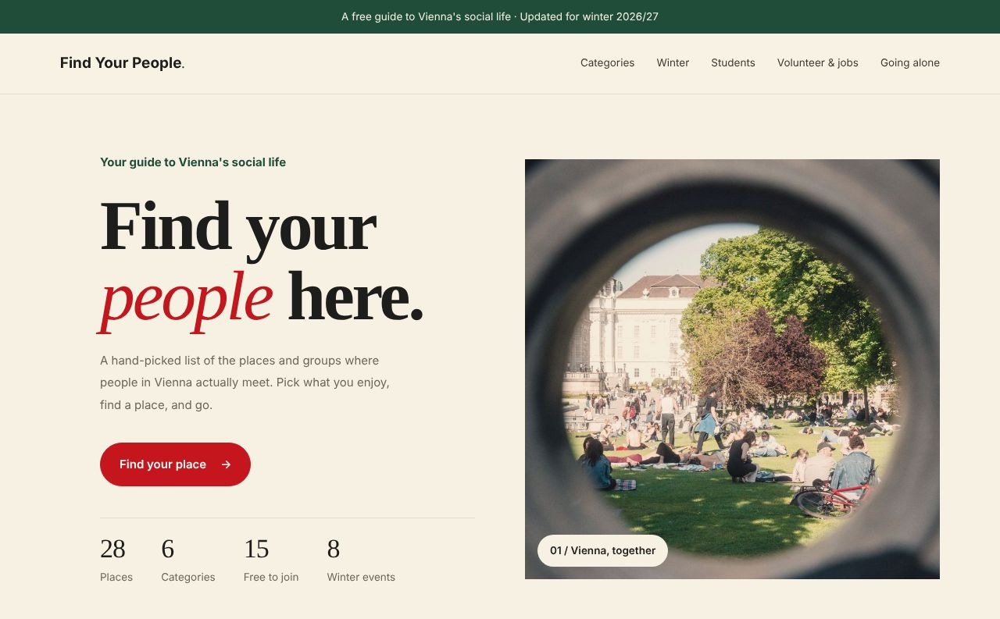

# Find Your People · Vienna

Where people in Vienna actually meet: a free guide for newcomers, students and anyone starting over. Language nights, games, run clubs, hobbies, volunteering, student life and side jobs, all in one place.

## Why this exists

I live in Vienna but study in Krems, which means almost four hours of commuting a day, plus work on weekends. Meeting new people in my own city felt like something that happened to everyone else. So I started collecting the places where people here actually meet, and turned that list into this guide.

## What's inside

- **Six categories:** Talk & languages, Games & quizzes, Active & outdoors, Hobbies & classes, Volunteering and Students. Each place lists when, where, cost and language, and is tagged shy-friendly or chatty.
- **Winter 2026/27 timetable:** Christmas markets, ice rinks, New Year's Eve and student balls, with a live "today" marker.
- **Student guide:** university networks (ESN, buddy programmes), USI sports and student-priced balls.
- **Volunteer & side jobs:** volunteering platforms, places to find part-time work, and the basics of your rights as a working student.
- **Going alone:** six tips for showing up somewhere new on your own.

## How it's built

It's a single static page, `index.html`, with plain HTML, CSS and JavaScript and no build step. The photos are in `img/`. Pages are switched with the URL hash (for example `#play`, `#winter`, `#students`), so links to a single category can be shared.

To run it locally, just open `index.html` in a browser.

## Keeping it accurate

Event times, places and prices change. Each entry links to its source, and the site asks visitors to check the link before going. Corrections and new places are very welcome: open an issue or a pull request.

The information on working rights is general and not legal advice.

## Photo credits

Photos from [Pexels](https://www.pexels.com), free to use under the Pexels licence, by Frank Wesneck, Gizem Erol, Karola G, Ron Lach, Picmatti, cottonbro studio, Catarina, Rahela Ulici, Riccardo Lucon, SilverKBlack and WR Heustis.
